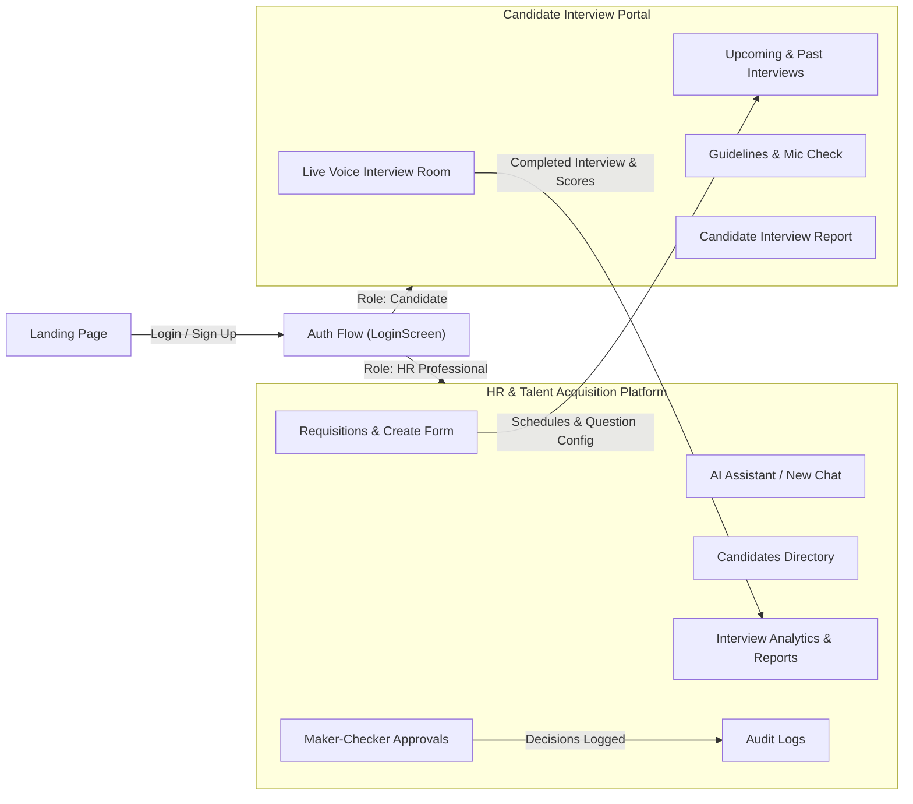

# VEYRA — AI Interview & Talent Intelligence Platform

An interactive web application connecting **HR & Talent Acquisition operations** with a **guided Candidate AI Interview Portal** inside one unified recruitment ecosystem.

---

## Overview

VEYRA streamlines end-to-end hiring across two role-based workspaces accessible from the landing page and authentication flow:

1. **Landing & Authentication (`LandingPage`, `LoginScreen`)**
   - Product overview with animated hero showcase, feature highlights, governance pillars, and demo inquiry form.
   - Role-based **Login** and **Sign Up** flows supporting **HR Professional** and **Candidate** portals.

2. **HR & Talent Acquisition Platform (`src/components/hr/`)**
   - **AI Assistant (`AiAssistantView`)**: Conversational workspace with categorized recommended prompts, inline structured requisition creation and editing, candidate shortlisting cards, approval/rejection actions, and activity lookup.
   - **Requisitions (`RequisitionsView`)**: Searchable/filterable job requisition directory with status pills (`Approved`, `Pending`, `Unapproved`) and a multi-section `Create Requisition` workflow including interview configuration (`No. of Questions`, `Interview Duration`).
   - **Candidates (`CandidatesView`)**: Full applicant table with search, job/status filters, score pills, and drill-down into evaluation reports.
   - **Approvals (`ApprovalsView`)**: Maker-checker approval queue grouped into `Recent candidates` and `Tech Based-jobs` with instant `Approve` / `Reject` controls.
   - **Interviews & Analytics (`InterviewAnalyticsView`)**: KPI summary dashboard, interview session log, CSV report export, and detailed candidate evaluation report (`AI Recommendation`, `Key Strengths`, `Behavioural Analysis` trait bars, and expandable `Candidates Responses` with transcript copy and speech playback).
   - **Audit Logs (`AuditLogsView`)**: Chronological governance trail recording sign-ins, requisition updates, interview completions, and approval decisions.

3. **Candidate Interview Portal (`src/components/candidate/CandidatePortal.jsx`)**
   - **Dashboard**: Personalized greeting, `Upcoming Interviews` (with 30-minute pre-join gating tooltip), and `Past Interviews` history.
   - **Pre-Interview Instructions & Device Check**: Interactive `Interview Guidelines` modal, environment rules with irreversible-progression notice, and microphone readiness verification (`Media devices ready`).
   - **AI Interview Room**: 10-question `Interview Progress` rail, stepped progress indicator, per-question 1-minute countdown timer, text-to-speech question playback, voice recording (`MediaRecorder` with timer fallback), audio playback scrubber, `Re-record`, and `Submit Response`.
   - **Interview Report**: Post-interview performance breakdown (`Overall Score`, `Technical Skills`, `Communication`, `Behavioural Problem Solving`), 6 normalized `Behaviour Traits`, expandable per-question responses, and HTML/print report views.

---

## Architecture

### High-Level Application Flow



### State & Component Architecture

`src/App.jsx` acts as the centralized state coordinator so actions across the HR workspace and Candidate Portal reflect immediately in shared state:
- **`requisitions`**: Shared across `AiAssistantView`, `RequisitionsView`, and `InterviewAnalyticsView` KPIs.
- **`candidates`**: Shared across `AiAssistantView`, `CandidatesView`, `ApprovalsView`, and `InterviewAnalyticsView`.
- **`upcomingInterviews` / `pastInterviews`**: Updated live when a candidate finishes an interview inside `CandidatePortal`.
- **`auditLogs`**: Appended automatically on authentication, requisition creation/edits, candidate approvals/rejections, and completed interviews.

### Project Structure

```text
Veyra/
├── index.html                          # Open Sans & Google Material Symbols fonts
├── tailwind.config.js                  # Color tokens & Open Sans theme config
├── public/
│   └── assets/
│       └── media/veyra-hero.mp4        # Hero animation video
└── src/
    ├── App.jsx                         # Root router & shared application state
    ├── index.css                       # Global Open Sans & utility styles
    ├── data/
    │   └── mockData.js                 # Initial requisitions, candidates, questions, logs
    └── components/
        ├── GoogleIcon.jsx              # Material Symbols Outlined wrapper
        ├── SelectField.jsx             # Custom pill dropdown component
        ├── TopBar.jsx                  # Header, notifications, help & account menu
        ├── LandingPage.jsx             # Public product overview & demo form
        ├── LoginScreen.jsx             # Role-based Login, Sign Up & Reset flow
        ├── hr/
        │   ├── HrSidebar.jsx           # Features & chat thread navigation
        │   ├── AiAssistantView.jsx     # Conversational ATS & inline cards
        │   ├── RequisitionsView.jsx    # Requisitions table & creation form
        │   ├── CandidatesView.jsx      # Candidate directory & filters
        │   ├── ApprovalsView.jsx       # Maker-checker approval cards
        │   ├── InterviewAnalyticsView.jsx # KPIs, sessions & evaluation reports
        │   └── AuditLogsView.jsx       # Governance audit log table
        └── candidate/
            └── CandidatePortal.jsx     # Dashboard, guidelines, room & report
```

---

## Tech Stack

- **Frontend**: React 18, Vite 6
- **Styling**: Tailwind CSS 3
- **Typography & Icons**: Open Sans & Google Material Symbols Outlined
- **Browser APIs**: Web `MediaRecorder` API (voice capture with simulation fallback) & Web Speech API (`speechSynthesis` for question/answer audio playback)

---

## Getting Started

```bash
# Install dependencies
npm install

# Start the development server
npm run dev

# Build for production
npm run build

# Preview production build
npm run preview
```
